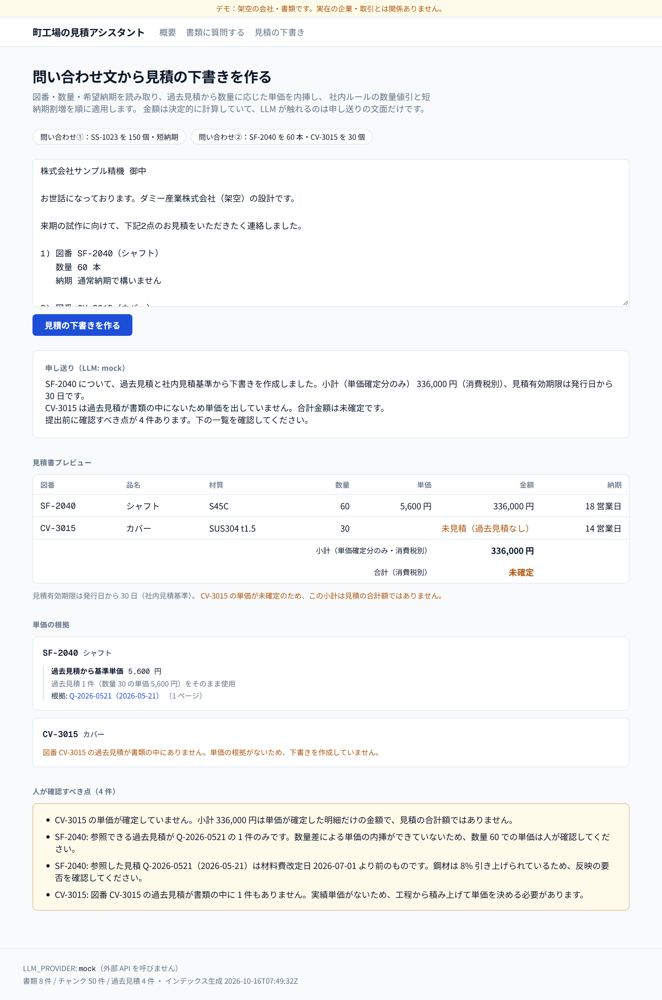
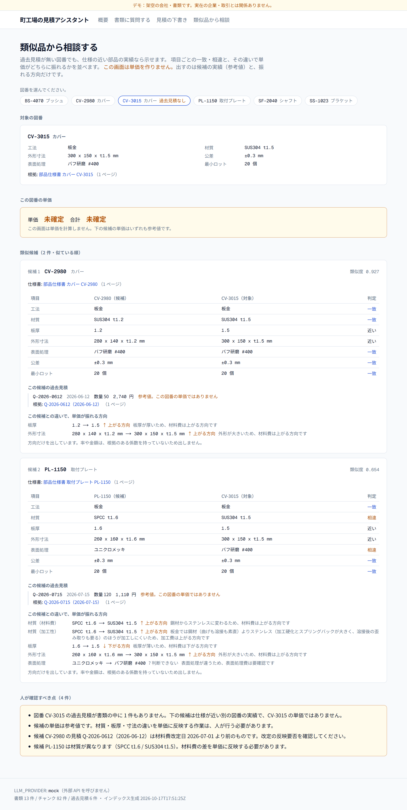

# Manufacturing Quote Assistant (Demo)

Live demo: https://mfg-quote-assistant.vercel.app (fictional company and documents)

Ask a question against thirteen internal manufacturing documents (PDFs) and you get an answer plus
its **citation** — document, page and the quoted passage. Paste an inquiry email and it reads the
part number, quantity and lead time, drafts a quote from past quotes and the internal pricing
rules, then writes the two messages that come next: the internal question and the first reply to
the customer. The money is computed in code; **the LLM only writes the prose**. Unit price, volume
discount and rush surcharge are pinned by tests, so changing the model does not change the figure.
A part with no quote history gets no unit price — it shows as **"not priced"**, the total reads
**"not settled"**, and the parts closest to it in spec are listed with citations instead.
Every company, part number and document here is fictional.

Built with Next.js (TypeScript) and Python. It runs on a `mock` provider that calls no external
API by default; one environment variable switches it to Claude.

---

## What it does

### 1. Ask the documents (`/ask`)


You get an answer plus **citation cards** (document, page, excerpt). Clicking a card jumps to
that page in the document viewer and highlights the quoted passage.

| Question | What comes back |
| --- | --- |
| What did we quote for SS-1023 last time? | Latest quote no., date, quantity, unit price, amount, lead time, plus the two earlier ones |
| What is the rush surcharge? | The 10/7/5 business-day tiers, and that it applies after the volume discount |
| What material and finish is SF-2040? | Material, finish, dimensions, tolerance, minimum lot, standard lead time |
| What did we quote for CV-3015 last time? | **"Not found in the documents."** (a part with a spec sheet but no quote history) |

The fourth one is the point: when there is no basis, it does not invent a price.

`/ask?q=<question>` opens the page with that question already answered, so a link can be shared.

### 2. Draft a quote from an inquiry (`/quote`)


Paste an inquiry email. It extracts part number, quantity and requested lead time, then builds
a unit price from past quotes and the internal pricing rules. You get more than a number:

- **Where the price came from** — base price → volume discount → rush surcharge, one step at a
  time, each with the before/after figure and the document and page it used.
- **Points a human must check** — the reasons this draft cannot go out as is.
- **No unsettled figure presented as settled** — if even one line has no price, the money column
  becomes "subtotal (priced lines only)" and the total reads "not settled".

Actual output for sample 1 (SS-1023, 150 pcs, 10 business days):

```
Interpolated between 100 pcs @ 2,310 JPY and 200 pcs @ 1,980 JPY  -> 2,145 JPY
3% volume discount, 100+ pcs (Internal rule 4, p1)                -> 2,081 JPY
20% rush surcharge, within 10 business days (Internal rule 5, p1) -> 2,497 JPY
Total 374,550 JPY (excl. tax)

Points a human must check (1)
- Quote Q-2026-0325 (2026-03-25) predates the 2026-07-01 material cost revision.
  Steel went up 8%; confirm whether that needs to be reflected.
```

Sample 2 produces both a part with only one past quote (cannot interpolate) and a part with no
quote history at all (no draft produced). Because of the latter:

```
SF-2040  qty 60   5,600 JPY   336,000 JPY   18 business days
CV-3015  qty 30   not priced (no quote history)   14 business days

                  Subtotal (priced lines only, excl. tax)   336,000 JPY
                  Total (excl. tax)                         not settled

Points a human must check (4)
- CV-3015 has no settled unit price. The 336,000 JPY subtotal covers only the priced lines
  and is not the quote total.
- SF-2040: only one past quote (Q-2026-0521) is available, so no interpolation...
- SF-2040: Q-2026-0521 (2026-05-21) predates the material cost revision...
- CV-3015: no past quote exists for this part number at all...
```

The subtotal is never presented as the total. That is driven by `hasUnquotedItems` from
`quote.ts` and pinned by vitest.



*A part with no quote history gets no unit price — it shows as "not priced", and the subtotal is
explicitly marked as not being the total*

`/quote?sample=inquiry-01` (or `inquiry-02`) opens the page with that sample already drafted.

#### What comes next

Below the draft sit two collapsed panels holding **the work that follows**. Stopping at the draft
leaves the rest of the exchange in someone's head.

- **The internal question** — every "point a human must check", turned into a question. If a line
  has no price, it links to `/similar?part=…`.
- **The first reply to the customer** — priced lines carry their figures; an unpriced line says
  "we will confirm the unit price and reply within 3 business days".

Actual output for sample 2:

```
SF-2040  qty 60  5,600 JPY  336,000 JPY  18 business days
CV-3015  qty 30  we will confirm the unit price and reply within 3 business days

The subtotal for the priced lines is 336,000 JPY (excl. tax).
CV-3015 is not priced yet, so the overall total is not settled.
```

That the unsettled total never appears as a figure is pinned by vitest (the text must not contain
`合計 <number> 円`). The wording comes from a deterministic template in `lib/followup.ts`; no LLM
is involved.

### 3. Find similar parts (`/similar`)



A part with no quote history still has neighbours. **This page does not produce a unit price** —
the unit price and total both read "not settled". What it gives you is:

- **The target's spec**, with a citation into the spec sheet.
- **Ranked candidates** (up to three). Process, material, thickness, outline, finish, tolerance and
  minimum lot are compared one row at a time. Each candidate's past quotes come with quote number,
  date, quantity and unit price plus a citation — and the unit price always carries
  **"reference only; not this part's price"**.
- **Which way the price moves** — "thickness 1.2 → 1.5 ↑ upward", arrows and words only.
  **No percentages, no money**: there is no defensible coefficient behind them.
  Material gets **two separate rows — stock cost and workability** — because the two can point in
  opposite directions, and a single ranking hides the cancellation. Workability depends on the
  process, so that table is split between sheet metal and turning.
- **Points a human must check**, in the same form as `/quote`.

Actual output for CV-3015 (the part with no quote history):

```
Candidate 1  CV-2980  cover                                  similarity 0.927
  process sheet metal / sheet metal   material SUS304 t1.2 / SUS304 t1.5   finish same
  Q-2026-0612 (2026-06-12)  qty 50  2,740 JPY  reference only; not this part's price
  thickness  1.2 -> 1.5   ^ upward
  outline    280x140 -> 300x150   ^ upward

Candidate 2  PL-1150  mounting plate                         similarity 0.654
  material / stock cost   SPCC t1.6 -> SUS304 t1.5   ^ upward (carbon steel to stainless)
  material / workability  SPCC t1.6 -> SUS304 t1.5   ^ upward
                          stainless is harder to form (work hardening, springback)
  finish                  zinc chromate -> #400 buffed   ? cannot say

Unit price: not settled / Total: not settled
```

The two can point **opposite ways**. Seen from SF-2040 (turned, S45C), candidate BS-4070
(turned, C3604):

```
material / stock cost   C3604 -> S45C   v downward (brass to carbon steel)
material / workability  C3604 -> S45C   ^ upward
                        in turning, free-cutting brass cuts more easily than carbon steel
```

Free-cutting brass is the pricier stock but the easier cut. A single ranking would have hidden
that. The opposite-direction case is pinned by vitest.

If nothing reaches the floor (0.45), it lists no candidates and says **"no close part in the
documents"** instead. SF-2040 (turned) is exactly that case. Listing a candidate that merely grazes
the threshold reads as "there is something close", so it is cut the same way `answer.ts` cuts
weak search hits.

`/similar?part=CV-3015` opens the page on that part.

---

## Design notes

### Deterministic math, LLM only formats

If an LLM produces the numbers, nobody notices when it quietly gets a digit or a tier wrong.
So the responsibilities are split:

```
unit price, discount, surcharge, lead time  -> web/lib/quote.ts   pure TypeScript, no LLM
facts the answer may use                    -> web/lib/answer.ts  derived deterministically
Japanese prose                              -> web/lib/llm/*      the only place an LLM runs
```

The LLM receives **already-computed numbers**, and the prompt tells it not to go beyond the
given facts and to say so when there are none. Swap the model and the money does not move.
On `/ask`, expanding "how this answer was assembled" shows the exact facts handed to the LLM.

A useful side effect: every price path is pinned by tests (`web/tests/quote.test.ts`).

### BM25 rather than embeddings

Part numbers (`SS-1023`) and rates (`3%`) are short tokens where exactness matters, and vector
search is weak on them — plus generating embeddings would require an external API.

Japanese is indexed as **character bigrams** rather than through a morphological analyser, which
would mis-split part numbers and material codes that are not in its dictionary. Alphanumerics are
indexed both whole (`ss-1023`) and split (`ss`, `1023`).

Bigrams do produce false hits — Japanese for "bracket" and "robot" share a bigram. A relevance
floor in `answer.ts` turns those into "not found" rather than a confident wrong answer.

### pdfplumber table extraction

Quote figures live in ruled tables. Splitting text on whitespace shifts a column whenever a cell
contains a space (`SPCC t3.2`), which swaps unit price and amount. `extract_tables()` recovers
cell boundaries from the rules, so that cannot happen. Only the grand total, which sits outside
any table, is matched with a regular expression.

### Citations that cannot drift

Chunks never span pages — if they did, "which page" would stop having one answer. Chunks are cut
at section headings, and the heading stays as the first line of the chunk so an excerpt reads on
its own.

---

## Layout

```
mfg-quote-assistant/
  data/
    source/      fictional source documents (YAML / Markdown)
    pdf/         generated PDFs (committed)
    fonts/       IPAexGothic (IPA Font License v1.0 included)
  ingest/        Python: PDF generation, extraction, chunking, field extraction (48 pytest)
  web/           Next.js App Router + TypeScript (158 vitest)
```

---

## Running locally

Regenerating the documents is optional — the outputs are committed.

```bash
cd ingest
python -m venv .venv
source .venv/bin/activate      # Windows: .\.venv\Scripts\Activate.ps1
pip install -e ".[dev]"

python -m ingest.make_pdfs     # data/source/*.yaml -> data/pdf/*.pdf
python -m ingest.build_index   # data/pdf/*.pdf -> web/public/*.json
python -m pytest
```

```bash
cd web
npm install
npm run dev        # http://localhost:3000
```

```bash
cd web
npm run lint
npm run typecheck
npm test
npm run build
```

---

## Switching to Claude

The default is `mock`. `LLM_PROVIDER` unset, empty or unrecognised all resolve to `mock`; only an
explicit `claude` calls the Anthropic API. `lib/llm/claude.ts` is loaded via dynamic import, so
while the provider is `mock` the Anthropic SDK is never even evaluated.

```bash
# web/.env.local (git-ignored)
LLM_PROVIDER=claude
ANTHROPIC_API_KEY=sk-ant-...
ANTHROPIC_MODEL=claude-opus-5-5   # optional
```

Only the wording changes. Prices, citations and review points stay identical. The footer shows
which provider is active.

> This bills against your Anthropic account. Tests, builds and CI all run on `mock`.

---

## Limits

- No auth, no database. The data is static JSON.
- Quantity interpolation stays inside the observed range; outside it the nearest unit price is
  used without extrapolation, and that is surfaced as a review point.
- The internal rule figures come from YAML (regex over prose is brittle), but the cited page
  numbers come from the extracted PDF, so a drift between the two fails the tests.
- The minimum-order-value branch (30,000 JPY) is unreachable with the current fictional data.
- The similarity weights in `/similar` (process 0.35, material 0.20, thickness 0.15, outline 0.10,
  finish 0.10, tolerance 0.05, minimum lot 0.05) and the 0.45 floor were not tuned against real
  data. They encode one ordering — "a different process makes the figure unusable" — and would
  need fitting against actual quotes before use.
- `/similar` only ever says upward, downward or cannot-say. Withholding a percentage is the point,
  not a gap: there is no coefficient behind one.
- The workability table (turning: brass → aluminium → carbon steel → stainless, easiest first;
  sheet metal: carbon steel → brass → aluminium → stainless) is shop common sense written down,
  not something fitted to real jobs. A process or material missing from the table gets no ranking
  at all — it falls through to "needs checking".

---

## Assets

`data/fonts/ipaexg.ttf` is IPAexGothic, under the IPA Font License v1.0. The full licence text is
included in the same directory.
