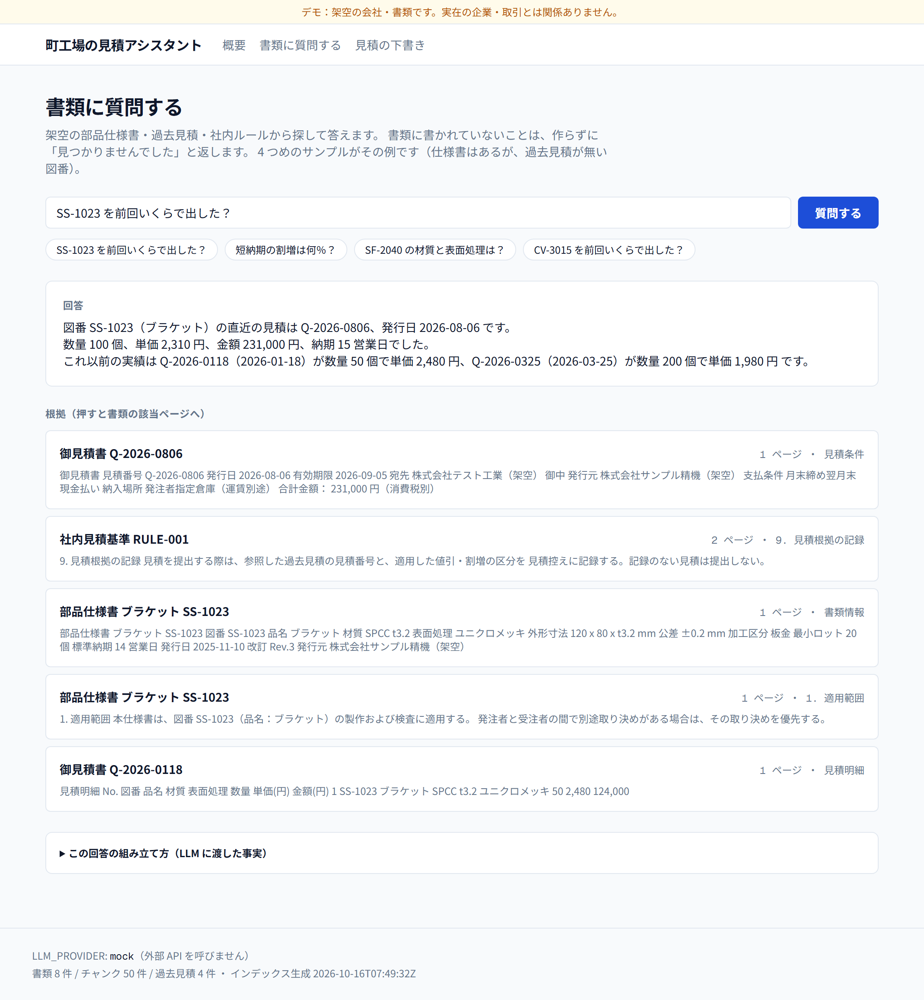
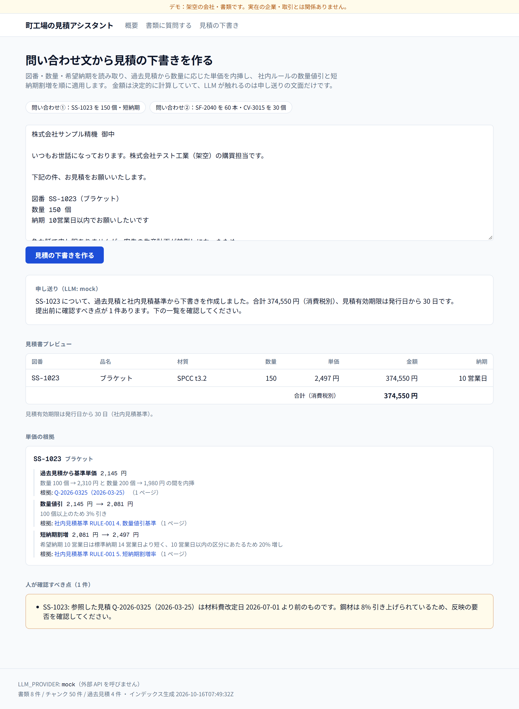

# 町工場の見積アシスタント（デモ）

製造業の書類（PDF）から、**根拠つきで答える**／**問い合わせ文から見積の下書きを作る**、を
ブラウザで試せるデモです。書類・会社名・図番はすべて架空です。

既定では外部 API を一切呼びません（`LLM_PROVIDER=mock`）。Anthropic API に差し替えても、
**見積額は 1 円も変わりません**。理由は後述の「計算は決定的、LLM は整形だけ」にあります。

---

## 何ができるか

### 1. 書類に質問する（`/ask`）



質問を投げると、回答と**根拠カード**（書類名・ページ・該当箇所の抜粋）が出ます。
カードを押すと書類ビューアの該当ページへ飛び、引用元がハイライトされます。

| 質問 | 返るもの |
| --- | --- |
| SS-1023 を前回いくらで出した？ | 直近の見積番号・発行日・数量・単価・金額・納期と、過去 2 件の実績 |
| 短納期の割増は何％？ | 10/7/5 営業日の 3 区分と、値引のあとに掛ける旨 |
| SF-2040 の材質と表面処理は？ | 材質・表面処理・寸法・公差・最小ロット・標準納期 |
| CV-3015 を前回いくらで出した？ | **「書類からは見つかりませんでした」**（仕様書はあるが、過去見積が無い図番） |

4 つめが重要です。該当が無いときに単価をでっち上げないことを、動く形で示しています。

`/ask?q=<質問>` で、特定の質問を開いた状態のリンクを共有できます。

### 2. 問い合わせ文から見積の下書き（`/quote`）



問い合わせメールを貼ると、図番・数量・希望納期を読み取り、過去見積と社内ルールから
単価を組み立てます。出るのは金額だけではありません。

- **単価の根拠**：「過去見積から基準単価 → 数量値引 → 短納期割増」を 1 段ずつ、
  いくらからいくらになったか・どの書類の何ページを使ったかつきで表示します。
- **人が確認すべき点**：そのまま出してはいけない理由を列挙します。

サンプル①（SS-1023 を 150 個・10 営業日）の実際の出力：

```
数量 100 個 2,310 円 と 数量 200 個 1,980 円 の間を内挿   → 2,145 円
100 個以上のため 3% 引き（社内見積基準 4. 数量値引基準 p1） → 2,081 円
10 営業日以内のため 20% 増し（同 5. 短納期割増率 p1）      → 2,497 円
合計 374,550 円（消費税別）

人が確認すべき点（1 件）
・参照した見積 Q-2026-0325（2026-03-25）は材料費改定日 2026-07-01 より前のものです。
  鋼材は 8% 引き上げられているため、反映の要否を確認してください。
```

サンプル②では、過去見積が 1 件しか無い図番（内挿できない）と、
過去見積がまったく無い図番（下書きを作らない）が同時に出ます。

`/quote?sample=inquiry-01`（または `inquiry-02`）で、サンプルを流し込んだ状態のリンクを共有できます。

---

## 設計の要点

### 計算は決定的、LLM は整形だけ

見積の金額を LLM に出させると、桁や適用区分を静かに間違えたときに誰も気づけません。
そこで責務を切ってあります。

```
単価・値引・割増・納期   → web/lib/quote.ts   TypeScript の純粋関数（LLM を通さない）
回答に使ってよい事実     → web/lib/answer.ts  検索結果と構造化データから決定的に生成
日本語の文面            → web/lib/llm/*      LLM はここだけ
```

LLM に渡すのは**計算済みの数字だけ**で、プロンプトでも「与えられた事実の外に出るな」
「足りなければ無いと言え」を明示しています。だからモデルを替えても金額は動きません。
`/ask` の「この回答の組み立て方」を開くと、LLM に渡した事実そのものが見られます。

副作用として、金額まわりはすべてテストで固定できます（`web/tests/quote.test.ts`）。

### なぜ埋め込みでなく BM25 か

図番（`SS-1023`）や率（`3%`）のような、短くて正確さが要る語を取りこぼさないためです。
ベクトル検索はこの手の語に弱く、しかも埋め込みの生成に外部 API が要ります。

日本語は形態素解析器を使わず**文字 bi-gram**にしています。辞書に載っていない図番や
材質記号をかえって誤分割するためです。英数字は区切りを含む丸ごと（`ss-1023`）と
分解した形（`ss` / `1023`）の両方を索引します。

bi-gram は「ブラケット」と「ロボット」が `ット` を共有するような誤ヒットを生みます。
そこで `answer.ts` に下限スコアを置き、かすっただけの結果は
「見つかりませんでした」に倒しています。

### なぜ pdfplumber の表抽出か

見積書の金額は罫線つきの表に入っています。テキストを空白で分割する方式だと、
`SPCC t3.2` のように**値の中に空白を含むセル**で列が 1 つずれ、単価と金額が入れ替わります。
pdfplumber の `extract_tables()` は罫線からセル境界を復元するので、これが起きません。

表に入っていない値（合計金額）だけ、ページテキストに正規表現を当てています。

### 根拠のページがずれない作り

チャンクは**ページをまたぎません**。またぐと「何ページ目か」が一意に決まらず、
根拠として示せなくなるためです。章見出しで切り、見出し行はチャンク本文の 1 行目として
残します（抜粋だけ見て何の話か分かるように）。

---

## 構成

```
┌─ data/source/*.yaml ──┐   架空書類の元データ（人が読み書きする唯一の場所）
│                       │
│   make_pdfs.py        │   IPAexゴシックを埋め込んで A4 PDF を生成
├─ data/pdf/*.pdf ──────┤
│                       │
│   extract.py          │   pdfplumber：ページ単位のテキスト＋罫線表
│   chunk.py            │   見出し単位・ページをまたがないチャンク
│   fields.py           │   表のセルから金額・材質・納期を構造化
│   build_index.py      │
├─ web/public/*.json ───┤   index.json（検索用）/ quotes.json（構造化データ）
│                       │
│   lib/bm25.ts         │   検索
│   lib/answer.ts       │   事実の組み立て（決定的）
│   lib/quote.ts        │   見積計算（決定的）
│   lib/llm/*           │   文面の整形だけ（mock / claude）
└─ app/ ────────────────┘   /ask /quote /docs/[id]
```

```
mfg-quote-assistant/
  data/
    source/      架空書類の元データ（YAML / Markdown）
    pdf/         生成した PDF（コミット済み）
    fonts/       IPAexゴシック（IPAフォントライセンス v1.0 同梱）
  ingest/        Python：PDF 生成・抽出・チャンク化・項目抽出（pytest 46 件）
  web/           Next.js App Router + TypeScript（vitest 87 件）
```

---

## ローカルで動かす

### 1. 書類と検索インデックスを作る（任意）

生成物はコミット済みなので、元データを書き換えないかぎり不要です。

```powershell
cd ingest
python -m venv .venv
.\.venv\Scripts\Activate.ps1
pip install -e ".[dev]"

python -m ingest.make_pdfs     # data/source/*.yaml -> data/pdf/*.pdf
python -m ingest.build_index   # data/pdf/*.pdf -> web/public/*.json
python -m pytest
```

macOS / Linux では `source .venv/bin/activate` を使ってください。

### 2. 画面を起動する

```powershell
cd web
npm install
npm run dev
```

http://localhost:3000 を開きます。`/ask` と `/quote` はサンプル入力のボタンから試せます。

### 3. 検査を通す

```powershell
cd web
npm run lint
npm run typecheck
npm test
npm run build
```

---

## Claude に切り替える

既定は `mock` です。`LLM_PROVIDER` が未設定・空・未知の値のいずれでも `mock` になり、
`claude` と明示したときだけ Anthropic API を呼びます。
`lib/llm/claude.ts` は動的 import なので、`mock` のあいだは Anthropic SDK 自体が読み込まれません。

```powershell
# web/.env.local（git 管理外）
LLM_PROVIDER=claude
ANTHROPIC_API_KEY=sk-ant-...
ANTHROPIC_MODEL=claude-opus-5-5   # 省略可
```

切り替えても変わるのは文面だけです。金額・根拠・「人が確認すべき点」は同じものが出ます。
現在どちらで動いているかは画面フッターに出ます。

> 従量課金が発生します。テスト・ビルド・CI はすべて `mock` のまま通ります。

---

## 収録している架空書類

| 書類 | 内容 |
| --- | --- |
| 部品仕様書 ×3 | SS-1023 ブラケット（板金）/ SF-2040 シャフト（切削）/ CV-3015 カバー（板金） |
| 過去見積 ×4 | SS-1023 が 3 件（50 / 200 / 100 個、材料費改定をまたぐ）、SF-2040 が 1 件 |
| 社内見積基準 ×1 | 数量値引・短納期割増・最小ロット・最低受注金額・材料費改定日・標準納期 |
| 問い合わせメール ×2 | `/quote` のサンプル入力（PDF にはしていません） |

デモが成立する前提（CV-3015 に見積履歴が無いこと、SF-2040 が 1 件だけであること）は
pytest で固定しています。書類を差し替えると、この前提が崩れた時点でテストが落ちます。

---

## 制約・未対応

- 認証・DB は入れていません。データは静的 JSON です。
- 数量の内挿は実績の範囲内だけで、範囲外では外挿せず最近傍の単価を使い、確認事項に出します。
- 社内ルールの数値は YAML を正としています（散文からの正規表現抽出は壊れやすいため）。
  ただし根拠として示すページ番号は PDF の抽出結果から引くので、PDF とずれるとテストが落ちます。
- 最低受注金額（30,000 円）を下回る分岐は、現在の架空データでは到達しません。

---

## ライセンス・素材

`data/fonts/ipaexg.ttf` は IPAexゴシック（IPAフォントライセンス v1.0）です。
ライセンス全文を同ディレクトリに同梱しています。
